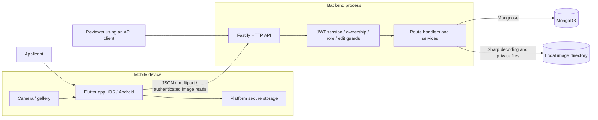
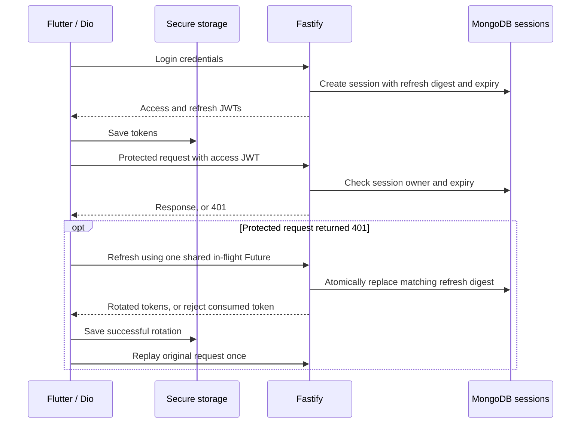

# System architecture

This document describes the implemented KYC onboarding system. Production extensions
and evidence gaps are listed separately below. The backend owns persisted onboarding
data, authorization, and verification status; the Flutter app collects data and displays
the server's decisions. Review decisions are made through the admin API. Automated
identity verification, OCR, biometric matching, and an admin web UI are future work.

## System boundaries

App and server have independent dependencies and builds in one repository. API
behavior is documented in [contracts](../contracts/README.md), including
[session/upload corrections](../contracts/session-and-upload-corrections.md) and
[submission semantics](../contracts/submission-api.md).

| Component | Responsibility | Source |
|---|---|---|
| Flutter bootstrap and routing | Select environment, create ProviderScope, redirect based on authentication | `app/lib/main.dart`, `app/lib/app.dart` |
| Feature presentation | Screens and Riverpod StateNotifiers for auth, details, documents, selfie, submission | `app/lib/features/*/presentation/` |
| Feature data and domain | API repositories, response mapping, typed feature models | `app/lib/features/*/data/`, `app/lib/features/*/domain/` |
| Shared mobile infrastructure | Dio authentication/replay, authenticated images, secure token and pending-key storage | `app/lib/core/` |
| HTTP boundary | Routes, JSON validation, multipart limits, error responses | `backend/src/server.ts`, `backend/src/schemas/`, `backend/src/routes/` |
| Authorization and business rules | Session validation, admin role checks, editable states, token rotation, image storage | `backend/src/middleware/`, `backend/src/services/` |
| Persistence | Mongoose models, indexes, database connection | `backend/src/models/`, `backend/src/plugins/database.ts` |

Route handlers currently also orchestrate database operations. Services extract shared
session, workflow, and image behavior; there is no separate repository layer on the server.

## Persistence and ownership

| Record | Relationship and contents |
|---|---|
| User | Account identity, password hash, role |
| Session | Many per user; session ID, refresh-token digest, expiry; TTL cleanup |
| PersonalDetails | One per user; date of birth, nationality, phone, address |
| Document | One per user and document type; document number, private file metadata, document status |
| Selfie | One per user; private file metadata and selfie status |
| Submission | One per user; overall status, submission/review timestamps, reviewer, rejection feedback, attempt keys |

Protected user operations derive the owner from validated JWT claims. Resource reads
and writes constrain access by that owner; admin review routes additionally require
the admin role. Image bytes live outside MongoDB and are read through authenticated
endpoints. File paths are omitted from document/selfie JSON responses.

Saved server data can be reloaded. Unsaved form edits and Riverpod state are in memory.
Secure storage holds access/refresh tokens and a pending submission key, rather than
a complete encrypted offline draft. Account changes invalidate feature state and
discard responses belonging to a previous session.

## Authentication and session lifecycle

Access and refresh JWTs use separate signing secrets and bind to a server session.
Every authenticated request checks that session, so logout revokes both token types
by deleting the current session. Other logins remain independent. Mobile logout waits
for an active refresh before clearing local tokens and the pending submission key.
Authentication endpoints do not trigger automatic refresh/retry. A lost refresh
response can require login because the previous refresh token has already been consumed.

## Capture, upload, and submission

1. The applicant saves personal details and selects/captures document and selfie images.
2. Flutter sends multipart uploads to the backend. The server checks ownership and
   edit permission, enforces a 10 MiB input limit, and decodes JPEG/PNG with Sharp
   with a 24 million pixel limit. Re-encoding strips metadata.
3. The server creates a random private file, updates its MongoDB metadata, then removes
   the replaced file after a confirmed write. An uncertain metadata write can leave
   an orphan for future reconciliation; there is no automatic orphan sweeper.
4. The app persists an attempt key before `POST /user/submit`. The server requires
   personal details, at least one document, and a selfie, then performs a conditional
   status update. Attempt keys are scoped to the authenticated user's submission.
5. On success, the app clears its pending key. On an uncertain response it retains
   the key for another attempt. A replay returns current server status rather than
   resetting a later review decision. Status is read through `GET /user/submission`.

Uploads replace the user's current resource; they do not have a dedicated server
idempotency-key protocol. The submission key protocol does not establish exactly-once
upload processing or a general offline retry queue.

```mermaid
stateDiagram-v2
    [*] --> draft: First submission record created
    draft --> submitted: Required data exists; submit
    submitted --> approved: Admin approval
    submitted --> rejected: Admin rejection
    rejected --> submitted: Explicit resubmission
    rejected --> rejected: Correct a section
    approved --> [*]
```

Before the first submit, a user may have saved details/images with no Submission
record. The schema also supports `under_review`; admin decisions accept it, but no
delivered endpoint moves a submission into that state. Edits are allowed only with no
submission, or in `draft`/`rejected`. Correcting a rejected section clears its section
feedback while retaining rejected status until explicit resubmission. Approval and
rejection conditionally update only a pending submission, preventing competing review
decisions from both succeeding. Approved applications reject a new submission attempt;
a recognized earlier attempt key can still retrieve their current approved status.

## Runtime and deployment boundaries

The local setup runs Flutter against a Node.js process, MongoDB 7 in Docker (or a
configured Atlas database), and the backend's `UPLOAD_DIR`. Docker Compose binds the
local database to loopback and persists it in a named volume. A physical device needs
a reachable backend address; its `localhost` is the device itself. See the
[demo guide](interview-demo.md) and [mobile environments](../app/ENVIRONMENT.md).

Local HTTP is a development exception. A production deployment requires TLS at the
public boundary and protected database/storage connections. TLS termination and
hosting are deployment responsibilities, not provisioned infrastructure in this repo.
Secrets come from environment configuration; mobile environment assets are public
configuration and must not contain server credentials. No CI/CD deployment is implemented.

The current image adapter uses local disk. Multiple backend instances would need
coordinated image access or an S3-compatible adapter; a production object store and
signed URLs remain planned. MongoDB identity fields and local image bytes are not
application-encrypted. Production encryption/key management, protected temporary
capture files and backups, retention policy, and abandoned-data cleanup need further work.

There is no transaction spanning edits, image files, and submission records. Edit
guards and atomic status writes protect ordinary flows, but do not guarantee an
immutable submitted snapshot when an edit races with submission. Production work
should define snapshots/transactions and file reconciliation before claiming that guarantee.

## Evidence and decisions

Backend API tests use real isolated local MongoDB databases and synthetic image
fixtures. Flutter tests exercise API refresh, account isolation, submission-key
persistence, and startup rendering. These checks do not establish device camera,
full process-death recovery, or production storage behavior. Historical commands and
results are recorded in [AI usage](ai-usage.md) and the [demo guide](interview-demo.md).

This document supports the architecture/run documentation in R12 and explains the
design relevant to R2, R6–R10. It does not mark those acceptance criteria complete.
See [ADR-0008](adr/0008-interview-readiness-corrections.md) for current corrections
and limits, and the [ADR directory](adr/) for the underlying technology decisions.
